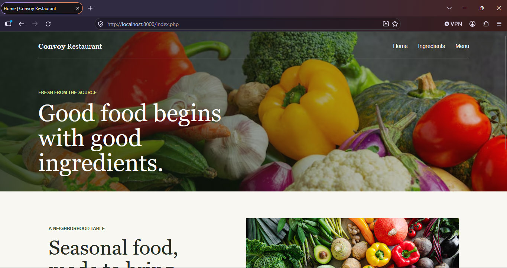
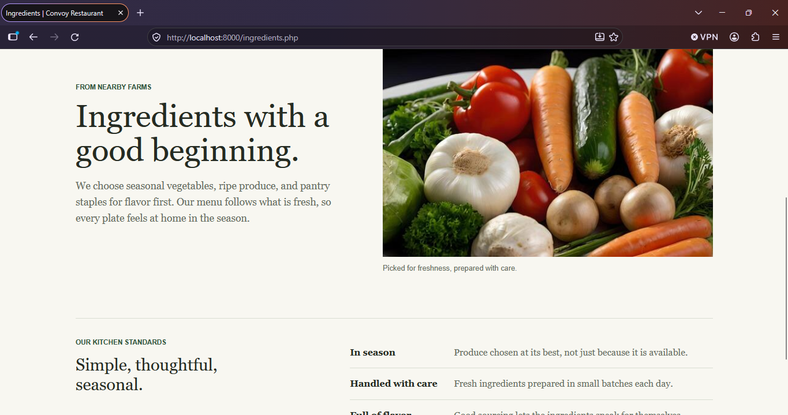

# Convoy Restaurant

A small PHP restaurant website with a home page, an ingredients page, and a sample menu. The pages share a header and footer, while each page can provide its own title and header background image.

## Pages

- `index.php` is the home page.
- `ingredients.php` describes the restaurant's approach to fresh ingredients.
- `menu.php` displays a sample seasonal menu.
- `inc/header.inc.php` renders the document head, navigation, and image-backed header.
- `inc/footer.inc.php` renders the shared footer and closes the document.

## Page-specific header images

Each page sets `$pageTitle` and `$headerImage` before including the shared header. For example, `ingredients.php` selects its own image:

```php
<?php
$pageTitle = 'Ingredients';
$headerImage = '../images/dine.png';
include 'inc/header.inc.php';
?>
```

The other pages use `../images/hoh.png` on the home page and `../images/table.png` on the menu page. The header include uses `images/cabs.png` as a fallback when a page does not set `$headerImage`.

The shared header escapes both page-provided values with `htmlspecialchars()` before writing them into HTML. It passes the image URL as the `--header-image` CSS custom property. `styles/site.css` uses that property as the background image and adds the common overlay, crop, and positioning. Since the CSS consumes the URL from `styles/site.css`, the page values start with `../images/` to resolve to the project's root `images/` directory.

## Shared PHP includes

Pages include `inc/header.inc.php` before their `<main>` content and `inc/footer.inc.php` after it. The header starts the HTML document; the footer prints the current year with PHP's `date('Y')` and closes the body and document. This keeps navigation and document structure consistent without duplicating markup on each page.

## Run locally

From the project directory, start PHP's built-in development server:

```sh
php -S localhost:8000
```

Then open [http://localhost:8000](http://localhost:8000) or navigate to `index.php`.

## Screenshots

### Home



### Ingredients


